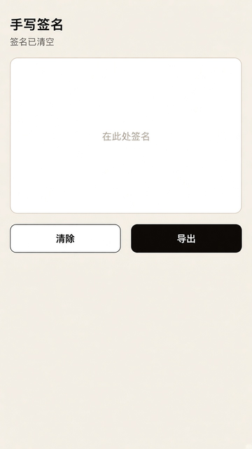
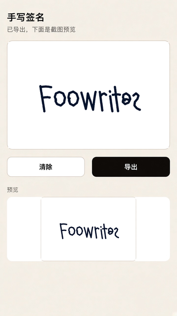

# KuiklySignaturePad

Kuikly 手写签名板，自研 DSL 与 Compose DSL 都能用。

作者：[@FooWrites](https://github.com/FooWrites)

## 效果

<table>
  <tr>
    <td></td>
    <td></td>
  </tr>
  <tr>
    <td align="center">清空</td>
    <td align="center">导出预览</td>
  </tr>
</table>

## 安装

```kotlin
repositories {
    mavenCentral()
    maven("https://jitpack.io")
}
```

自研 DSL：

```kotlin
implementation("com.github.FooWrites.KuiklySignaturePad:signaturepad:v0.1.1")
```

Compose DSL：

```kotlin
implementation("com.github.FooWrites.KuiklySignaturePad:signaturepad-compose:v0.1.1")
```

`signaturepad-compose` 已传递依赖 `signaturepad`。本库基于 Kotlin 2.1.21 / Kuikly 2.4.2-2.0.21 构建。

## 自研 DSL

```kotlin
SignaturePad {
    ref { padRef = it }
    attr {
        height(240f)
        placeholder("请在此签名")
        placeholderFontSize(16f)
        penColor(Color.BLACK)
        penWidth(3f)
    }
}

padRef.view?.clear()
padRef.view?.toImage { dataUri ->
    // dataUri 可预览，也可直接上传服务端；失败为 null
}
```

颜色用 `com.tencent.kuikly.core.base.Color`。默认导出 data URI；要文件路径或改采样用 `exportImage(ImageType.FILE)` / `exportImage(..., sampleSize)`。

## Compose DSL

```kotlin
val controller = remember { SignaturePadController() }

SignaturePad(
    modifier = Modifier.fillMaxWidth().height(240.dp),
    placeholder = "请在此签名",
    placeholderFontSize = 16f,
    controller = controller,
)

controller.clear()
controller.toImage { dataUri ->
    // 同上，拿去上传或预览
}
```

进阶导出用 `controller.exportImage(...)`。

## 示例

`:demo` 两页：`signature_pad_demo`、`signature_pad_compose_demo`。

## 许可

Apache License 2.0

Copyright (c) 2026 FooWrites
