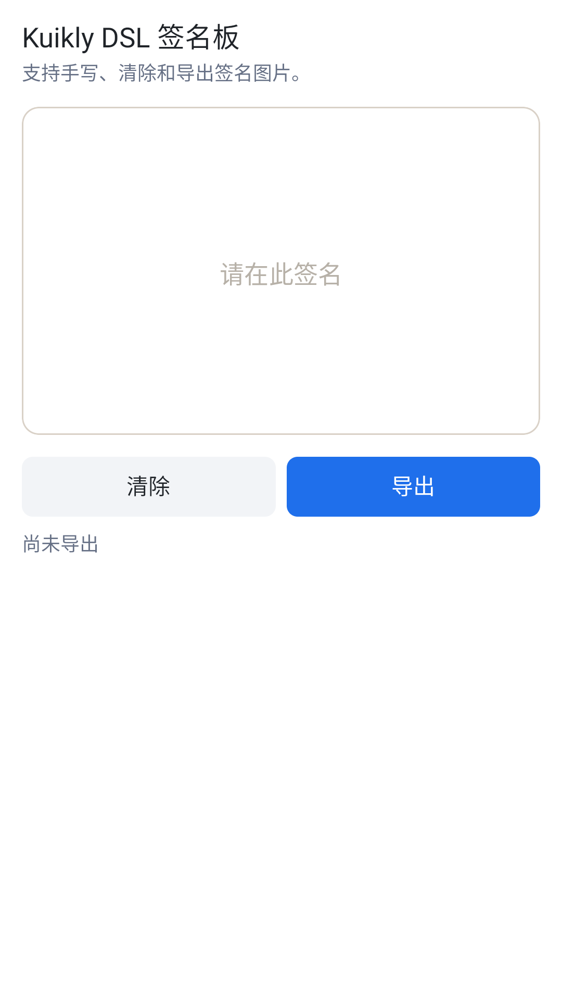
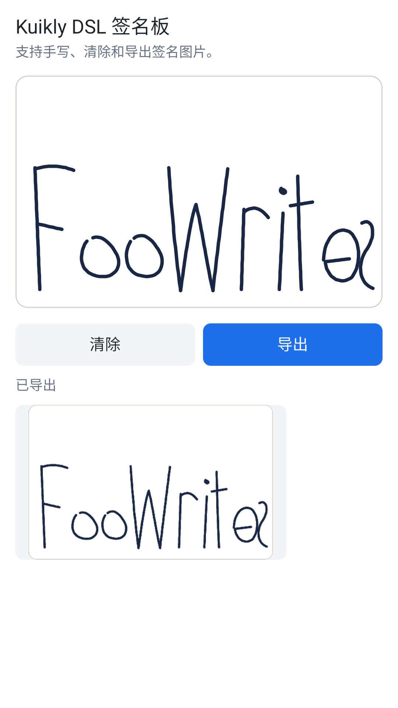
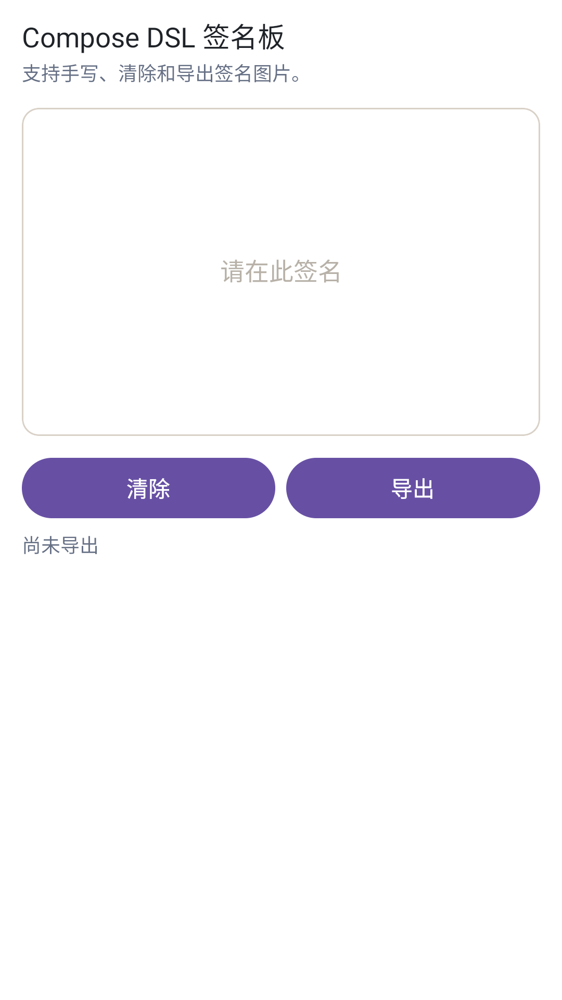
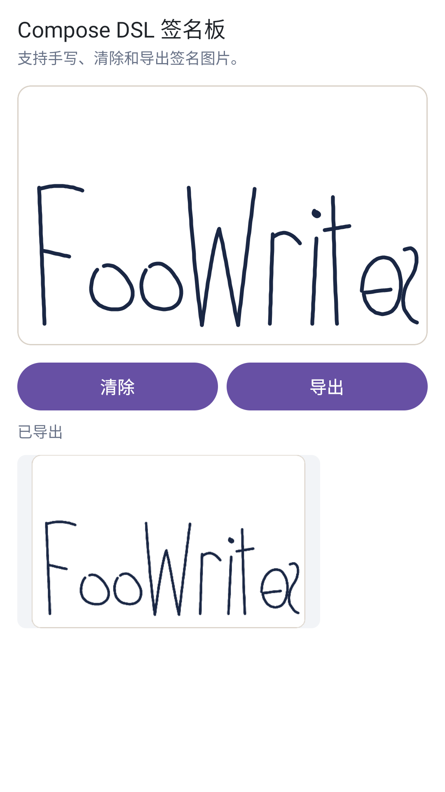

# KuiklySignaturePad

基于 Kuikly 的跨端手写签名板，支持 Android、iOS、HarmonyOS 和 H5。
提供 Kuikly DSL 和 Compose DSL 两个相互独立的模块，按页面使用的 DSL 引入其中一个即可。

## 安装

添加 JitPack 仓库：

```kotlin
repositories {
    maven { url = uri("https://jitpack.io") }
}
```

在 KMP 共享模块的 `commonMain` 中添加依赖：

| 模块 | Android / iOS / H5 | HarmonyOS |
|---|---|---|
| Kuikly DSL | `com.github.FooWrites.KuiklySignaturePad:signaturepad:0.2.1-2.1.21` | `com.github.FooWrites.KuiklySignaturePad:signaturepad:0.2.1-2.0.21-KBA-010` |
| Compose DSL | `com.github.FooWrites.KuiklySignaturePad:signaturepad-compose:0.2.1-2.1.21` | `com.github.FooWrites.KuiklySignaturePad:signaturepad-compose:0.2.1-2.0.21-KBA-010` |

版本号格式为 `{组件版本}-{Kotlin 版本}`。Android / iOS / H5 产物基于 Kotlin `2.1.21`、Kuikly `2.29.2-2.1.21` 构建；
HarmonyOS 产物基于 Kotlin `2.0.21-KBA-010`、Kuikly `2.23.2-2.0.21-ohos` 构建。

接入工程需自行依赖 `com.tencent.kuikly-open:core`，使用 Compose DSL 时还需依赖 `com.tencent.kuikly-open:compose`。

## Kuikly DSL

```kotlin
dependencies {
    implementation("com.github.FooWrites.KuiklySignaturePad:signaturepad:0.2.1-2.1.21")
}
```

### 使用

组件需要明确的宽高。通过 `ViewRef<SignaturePadView>` 清除和导出：

```kotlin
import com.kuikly.signature.SignaturePad
import com.kuikly.signature.SignaturePadView

var padRef: ViewRef<SignaturePadView>? = null

SignaturePad {
    ref { padRef = it }
    attr {
        width(320f)
        height(240f)
        penColor = Color(0xFF1A2744)
        penWidth = 3.5f
        placeholder = "请在此签名"
    }
    event {
        onSigned { hasInk -> /* 更新页面状态 */ }
    }
}

padRef?.view?.clear()
padRef?.view?.export { result ->
    if (result.success) {
        // result.data 为 data:image/png;base64,...
    }
}
```

### 属性

| 属性 | 类型 | 默认值 | 说明 |
|---|---|---|---|
| `penColor` | `Color` | `Color.BLACK` | 笔迹颜色，只影响之后的笔画 |
| `penWidth` | `Float` | `3f` | 笔迹宽度 |
| `boardColor` | `Color` | `Color.WHITE` | 画板底色 |
| `cornerRadius` | `Float` | `12f` | 圆角 |
| `borderWidth` | `Float` | `1f` | 边框宽度，`0` 表示无边框 |
| `borderColor` | `Color` | `Color(0xFFD9D1C7)` | 边框颜色 |
| `placeholder` | `String` | `"请在此处签名"` | 空白时的提示文字，空字符串不显示 |
| `placeholderColor` | `Color` | `Color(0xFFB7B1A8)` | 提示文字颜色 |
| `placeholderFontSize` | `Float` | `15f` | 提示文字字号 |

### 方法与事件

| 名称 | 说明 |
|---|---|
| `SignaturePadView.isEmpty` | 画板没有笔迹时为 `true` |
| `SignaturePadView.clear()` | 清除全部笔迹 |
| `SignaturePadView.export(type, sampleSize, callback)` | 导出图片，见[导出](#导出) |
| `SignaturePadEvent.onSigned { hasInk -> }` | 每笔结束或清除后回调，参数表示当前是否有笔迹 |

### 截图

| 空白 | 已导出 |
|---|---|
|  |  |

## Compose DSL

```kotlin
dependencies {
    implementation("com.github.FooWrites.KuiklySignaturePad:signaturepad-compose:0.2.1-2.1.21")
}
```

### 使用

组件需要通过 `modifier` 指定尺寸。通过 `SignaturePadComposeState` 清除和导出：

```kotlin
import com.kuikly.signature.compose.SignaturePadCompose
import com.kuikly.signature.compose.rememberSignaturePadState

val state = rememberSignaturePadState()

SignaturePadCompose(
    state = state,
    modifier = Modifier.fillMaxWidth().height(240.dp),
    penColor = Color(0xFF1A2744),
    penWidth = 3.5.dp,
    placeholder = "请在此签名",
    onSigned = { hasInk -> /* 更新页面状态 */ },
)

state.clear()
state.export { result ->
    if (result.success) {
        // result.data 为 data:image/png;base64,...
    }
}
```

### 参数

| 参数 | 类型 | 默认值 | 说明 |
|---|---|---|---|
| `modifier` | `Modifier` | `Modifier` | 需指定尺寸 |
| `state` | `SignaturePadComposeState` | `rememberSignaturePadState()` | 清除、导出和空白状态 |
| `penColor` | `Color` | `Color.Black` | 笔迹颜色，只影响之后的笔画 |
| `penWidth` | `Dp` | `3.dp` | 笔迹宽度 |
| `boardColor` | `Color` | `Color.White` | 画板底色 |
| `cornerRadius` | `Dp` | `12.dp` | 圆角 |
| `borderWidth` | `Dp` | `1.dp` | 边框宽度，`0.dp` 表示无边框 |
| `borderColor` | `Color` | `Color(0xFFD9D1C7)` | 边框颜色 |
| `placeholder` | `String` | `"请在此处签名"` | 空白时的提示文字，空字符串不显示 |
| `placeholderColor` | `Color` | `Color(0xFFB7B1A8)` | 提示文字颜色 |
| `placeholderFontSize` | `TextUnit` | `15.sp` | 提示文字字号 |
| `onSigned` | `(Boolean) -> Unit` | `{}` | 每笔结束或清除后回调，参数表示当前是否有笔迹 |

### 状态

| 名称 | 说明 |
|---|---|
| `isEmpty` | 画板没有笔迹时为 `true` |
| `clear()` | 清除全部笔迹 |
| `export(type, sampleSize, callback)` | 导出图片，见[导出](#导出) |

### 截图

| 空白 | 已导出 |
|---|---|
|  |  |

## 导出

两个模块的 `export` 用法相同，导出图片包含底色、边框和笔迹。
导出基于 Kuikly 的 `toImage`，支持 Android、iOS、HarmonyOS 和 H5；H5 不支持 `ImageType.FILE`。

| 参数 | 默认值 | 说明 |
|---|---|---|
| `type` | `ImageType.DATA_URI` | `DATA_URI` 返回 base64 图片，`CACHE_KEY` 返回可用于 `Image` 的缓存 key，`FILE` 返回文件路径（H5 不支持） |
| `sampleSize` | `1` | 采样率，取值大于或等于 1；值越大，输出图片越小 |
| `callback` | — | 回调 `SignatureExportResult` |

`SignatureExportResult` 的字段：

| 字段 | 说明 |
|---|---|
| `success` | `code == 0` 且 `data` 非空 |
| `code` | `0` 表示成功；`EMPTY_CODE`（`-2`）表示画板为空；`NOT_READY_CODE`（`-3`）表示画板尚未完成布局；其他非 0 值为 Kuikly `toImage` 返回的错误码 |
| `data` | 由 `type` 决定的图片数据 |
| `message` | 失败原因 |

## 开发

工程结构、Demo 运行和本地发布见 [开发文档](docs/development.md)。
