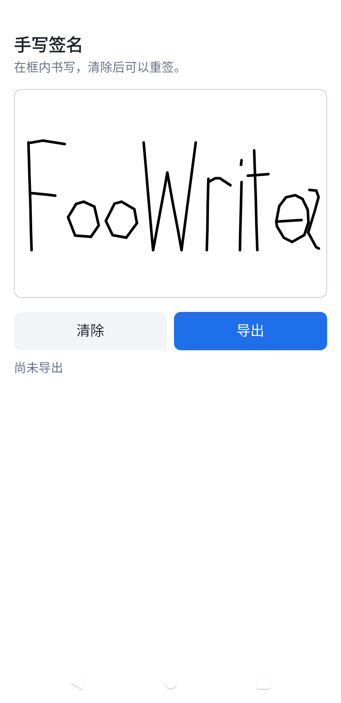

# KuiklySignaturePad

Kuikly 手写签名板，自研 DSL 与 Compose DSL 都能用。两套 DSL 共用一个纯 Kotlin 笔迹模型 `SignatureStrokes`，导出的 SVG / 点序列 JSON 格式一致。

作者：[@FooWrites](https://github.com/FooWrites)

## 效果

自研 DSL · Android

<table>
  <tr>
    <td></td>
    <td></td>
  </tr>
  <tr>
    <td align="center">空态</td>
    <td align="center">书写后</td>
  </tr>
</table>

空态显示占位「请在此签名」。书写后笔迹留在画板上，状态为「尚未导出」。

## 安装

```kotlin
repositories {
    mavenCentral()
    maven("https://jitpack.io")
}
```

自研 DSL：

```kotlin
implementation("com.github.FooWrites.KuiklySignaturePad:signaturepad:main-SNAPSHOT")
```

Compose DSL：

```kotlin
implementation("com.github.FooWrites.KuiklySignaturePad:signaturepad-compose:main-SNAPSHOT")
```

下文的 API 在 `v0.1.1` 之后的版本才有；新版本发布前请用 `main-SNAPSHOT`。`v0.1.1` 的 Compose DSL 版画板不可用，位图导出在 Android / iOS / H5 上回调永远不会触发。

`signaturepad-compose` 已传递依赖 `signaturepad`。本库基于 Kotlin 2.1.21 / Kuikly 2.4.2-2.0.21 构建。

## 导出

| 方式 | 自研 DSL | Compose DSL | 平台 |
| --- | --- | --- | --- |
| SVG | `toSvg()` | `state.toSvg()` | 全部 |
| 点序列 JSON | `toJson()` | `state.toJson()` | 全部 |
| 位图 | `toImage {}` / `exportImage(...)` | 无 | 见下 |

SVG 与 JSON 由纯 Kotlin 生成，不经过渲染层，坐标单位 dp/pt，保留一位小数。JSON 格式：

```json
{"width":320,"height":240,"strokes":[[x0,y0,x1,y1,...],[...]]}
```

位图导出调用 Kuikly 的 `toImage`。Kuikly 2.4.2 只有鸿蒙渲染层实现了它，Android / iOS / H5 从 Kuikly 2.17.0 起才支持。所以：

- 默认只在鸿蒙上调用 `toImage`，其他平台立即回调 `null`。
- 宿主渲染层已升级到 2.17.0 及以上时，用 `bitmapExportOnAllPlatforms(true)` 打开其他平台。
- 渲染层在 `timeoutMs`（默认 3000 ms）内没有响应也回调 `null`。回调恰好触发一次，不会挂起。
- 本仓库的鸿蒙宿主跑不起来（见下文），鸿蒙上的位图导出没有实机验证过。

需要可靠导出时用 SVG 或 JSON，交给服务端栅格化。

## 自研 DSL

```kotlin
SignaturePad {
    ref { padRef = it }
    attr {
        height(240f)
        placeholder("请在此签名")
        placeholderFontSize(16f)
        penColor(Color.BLACK)
        penWidth(3f)
    }
    event {
        onChange { isEmpty -> /* 一笔写完或清除后触发 */ }
    }
}

val pad = padRef.view ?: return
pad.isEmpty()
pad.clear()
val svg = pad.toSvg()
val json = pad.toJson()
pad.toImage { dataUri ->
    // 不支持位图导出的平台为 null，见「导出」
}
```

颜色用 `com.tencent.kuikly.core.base.Color`。其他属性：`paperColor(...)` 纸色，`minPointDistance(...)` 采样最小间距（默认 1.5）。`isBitmapExportSupported()` 可以在导出前判断当前平台。

## Compose DSL

```kotlin
val padState = rememberSignaturePadState()

ComposeSignaturePad(
    state = padState,
    modifier = Modifier.fillMaxWidth().height(240.dp),
    placeholder = "请在此签名",
    penColor = Color.Black,
    penWidth = 3.dp,
    onChange = { isEmpty -> },
)

padState.isEmpty
padState.clear()
val svg = padState.toSvg()
val json = padState.toJson()
```

包名是 `com.kuikly.signature.compose`。Compose 版用 `Box`、`Canvas`、`pointerInput` 实现，没有位图导出。

## 书写行为

- 已完成的笔画与正在书写的一笔分两层 Canvas。书写时只重绘当前这一笔，不会每次移动都把所有笔画重画一遍。
- 与上一采样点距离小于 `minPointDistance` 的移动点会被丢弃。
- 多指时只跟踪第一根落下的手指。这根手指抬起后，当前笔画结束；所有手指抬起后才能开始下一笔。

## 示例

`:demo` 两页，不发布：

- `signature_pad_demo`：自研 DSL，各端默认页
- `signature_pad_compose_demo`：Compose DSL

两页的「导出」都会生成 SVG 并显示字符数。自研 DSL 页同时尝试位图导出，平台不支持时会提示。

四个宿主壳也不发布。`jitpack.yml` 只发布 `:signaturepad` 和 `:signaturepad-compose`。

| 宿主 | 说明 |
| --- | --- |
| `:androidApp` | Android 宿主，默认打开自研 DSL 页。 |
| `iosApp/` | iOS 宿主，XcodeGen 与 CocoaPods。 |
| `ohosApp/` | 鸿蒙宿主工程结构，缺少 Kuikly 产物，无法构建。 |
| `:h5App` | H5 宿主。JS 产物没有页面入口，浏览器里看不到签名页。 |

KSP（`com.tencent.kuikly-open:core-ksp-jvm`，KSP `2.1.21-2.0.2`）给 Android 和 iOS 生成 `KuiklyCoreEntry`。已发布的 `core-js` 没有 `IKuiklyCoreEntry`，JS 源集没有挂 KSP，也没有页面注册代码。

### Android

默认页是自研 DSL。Compose DSL 用第二个启动命令。

```bash
./gradlew :androidApp:assembleDebug
adb install -r androidApp/build/outputs/apk/debug/androidApp-debug.apk
adb shell am start -n com.foowrites.kuikly.host/.KuiklyRenderActivity --es pageName signature_pad_demo
adb shell am start -n com.foowrites.kuikly.host/.KuiklyRenderActivity --es pageName signature_pad_compose_demo
```

不传 `pageName` 时打开 `signature_pad_demo`。宿主的 `KRImageAdapter` 只加载 base64 data URI 和本地文件，不处理网络图片。

### iOS

`iosApp/` 用 XcodeGen 和 CocoaPods。`OpenKuiklyIOSRender` 固定 KuiklyUI tag `2.4.2`。在 macOS 上：

```bash
brew install xcodegen cocoapods
./gradlew :demo:generateDummyFramework
cd iosApp
xcodegen generate
pod install
open iosApp.xcworkspace
```

默认页 `signature_pad_demo`。Compose 页：`KUIKLY_PAGE=signature_pad_compose_demo`。`Podfile` 不要加 `use_frameworks!`。

### 鸿蒙

`ohosApp/` 只有 DevEco 工程结构，跑不起来。`entry` 的 CMake 需要 `libs/<arch>/libshared.so` 和 `libshared_api.h`，它们应由 KMP 的鸿蒙目标产出；本仓库的库和 `:demo` 都没有鸿蒙目标，库也不发布鸿蒙 klib。

### H5

`:h5App` 依赖 `com.tencent.kuikly-open.core-render-web:base` 和 `:h5`，版本 `2.4.0-2.0.21`。`:demo` 的开发服务器在 8083，提供 `nativevue2.js`。已发布的 `core-js` 没有 `IKuiklyCoreEntry`，JS 没有页面入口，浏览器里看不到签名页。

```bash
./gradlew :demo:jsBrowserDevelopmentRun
# 另一个终端
./gradlew :h5App:jsBrowserDevelopmentRun
```

开发服务器地址是 <http://127.0.0.1:8080/> ，Compose 页参数是 `?page_name=signature_pad_compose_demo`。

## 许可

Apache License 2.0

Copyright (c) 2026 FooWrites
